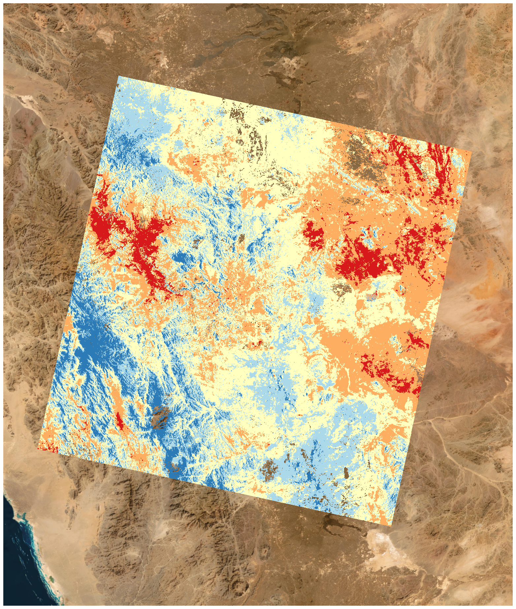
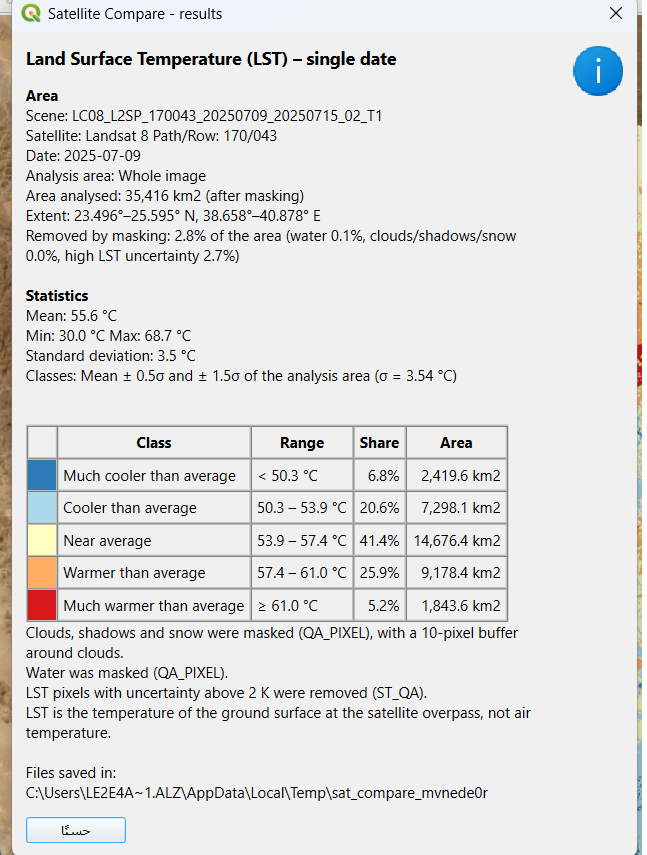
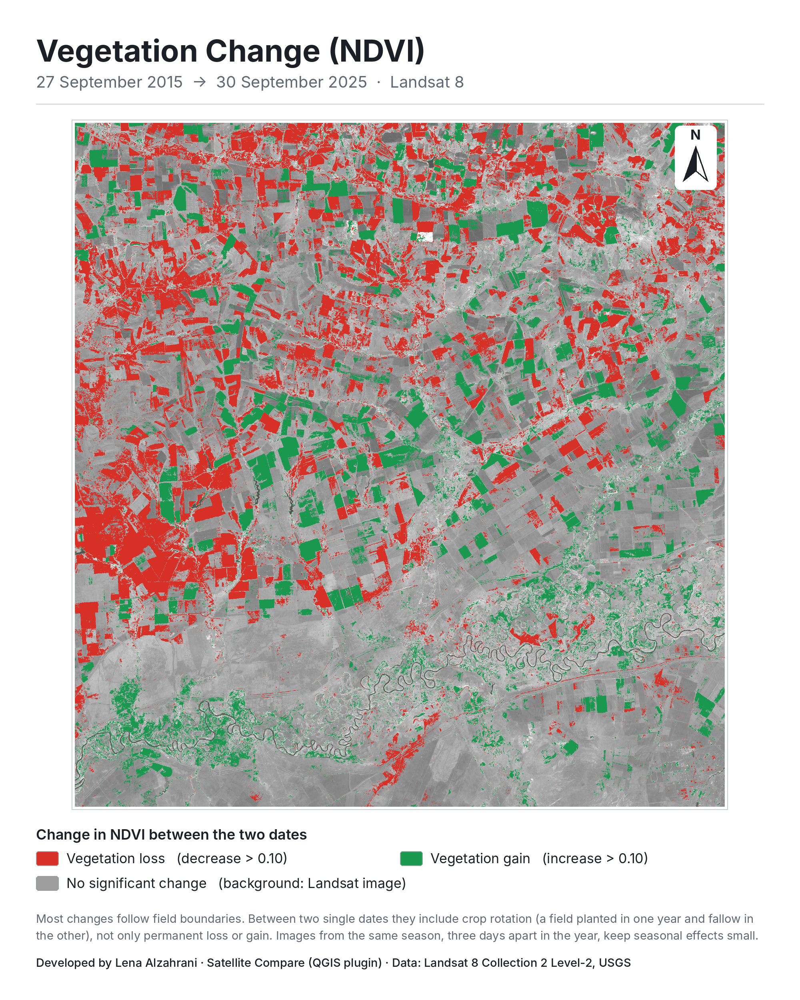

# Satellite Compare – QGIS plugin

Map and compare **vegetation (NDVI)** and **Land Surface Temperature (LST)** from
Landsat 8/9 Collection 2 Level-2 imagery, directly inside QGIS.

Developed by **Lena Alzahrani**, Geospatial Applications Officer.

---

## What it does

| | Single date | Compare two years |
|---|---|---|
| **NDVI** | Vegetation map in 4 classes | Vegetation loss / gain |
| **LST** | Surface temperature map in 5 classes | Cooling / warming |

For every run the plugin:

- computes the index from the raw Landsat bands (or uses rasters you already have)
- masks clouds, shadows, snow and (optionally) water using `QA_PIXEL`
- removes LST pixels with high uncertainty using `ST_QA`
- adds styled layers to the map, with class ranges written into the legend
- shows a results window: scene details, statistics, and a colour table with the share and area of each class
- saves GeoTIFFs, a text summary and a CSV of the class table

## Screenshots

| Results window | NDVI change |
|---|---|
|  |  |

## Installation

1. Download the latest `sat_compare.zip` from the [Releases](../../releases) page.
2. In QGIS: **Plugins → Manage and Install Plugins → Install from ZIP**.
3. The tool appears in the **Raster** menu and on the toolbar as **Satellite Compare**.

Requires QGIS 3.22 or later. No extra Python packages are needed: it uses NumPy and GDAL, which ship with QGIS.

## Input data

Download **Landsat 8 or 9, Collection 2, Level-2** scenes from
[USGS EarthExplorer](https://earthexplorer.usgs.gov/) and add these bands to your QGIS project:

| Index | Bands needed |
|---|---|
| NDVI | `SR_B4` (red), `SR_B5` (near infrared), `QA_PIXEL` |
| LST | `ST_B10` (surface temperature), `QA_PIXEL`, `ST_QA` (optional, recommended) |

Keep the original USGS file names: the plugin reads the satellite, path/row and date from them.

## How to use

1. **Mode** – single date or two-year comparison
2. **Input type** – raw Landsat bands, or ready index rasters
3. **Index** – NDVI or LST
4. **Image(s)** – choose the bands for each date
5. **Options**
   - **Analysis area** – whole image, current map view, or a polygon layer (selected features if any are selected)
   - **Mask clouds, shadows and snow** – with a buffer around clouds (default 10 pixels)
   - **Also mask water** – turn off in inland areas (see *Known limitations*)
   - **Max LST uncertainty** – default 2 K
   - **NDVI class limits** – default 0.2 / 0.4 / 0.6
   - **Change threshold** – default 0.10 for NDVI and 2 °C for LST

## Method

**Scale factors** (USGS Collection 2 Level-2):

- Surface reflectance = DN × 0.0000275 − 0.2
- Surface temperature (°C) = DN × 0.00341802 + 149.0 − 273.15

**NDVI** = (NIR − Red) / (NIR + Red)

**Single-date classes**

- *NDVI* – fixed limits: bare / built-up / sand < 0.2 ≤ sparse < 0.4 ≤ moderate < 0.6 ≤ dense.
  Limits are adjustable, because natural vegetation in arid regions often has NDVI below 0.2.
- *LST* – relative to the analysis area: mean ± 0.5σ and ± 1.5σ.
  This shows which surfaces are warmer or cooler than their surroundings, independent of how hot the day was.

**Masking**

- `QA_PIXEL` bits 1–4 (dilated cloud, cirrus, cloud, shadow) are removed with a square buffer; bits 0 and 5 (fill, snow) are removed as they are; bit 7 (water) is optional.
- `ST_QA` gives the LST uncertainty per pixel; pixels above the chosen limit are removed.
- The results window reports how much of the area was removed and why, and shows a warning when more than 50 % was removed.

## Known limitations

- **LST is not air temperature.** It is the temperature of the ground surface at the satellite overpass (about 10:30 local time). In summer, surfaces can be 15–20 °C hotter than the air.
- **Comparing LST between two single days includes weather.** Wind, humidity, dust and the sun angle on each day all change surface temperature. Use images close in day of year, on clear and calm days, and read change maps with care.
- **Terrain affects LST.** Higher ground is cooler, and in the morning slopes facing away from the sun are cooler. These patterns are real, but they are not land-cover change.
- **The water flag can misclassify dark rock.** In tests over the Al-Madinah region, basalt lava flows were flagged as water in `QA_PIXEL` and dropped from the analysis. Turn off *Also mask water* in inland areas without lakes or sea.
- **NDVI comparisons need the same season.** Comparing images from different months mostly measures crop calendars and seasonal growth, not real change.

## Roadmap

- Google Earth Engine integration: fetch imagery automatically and use multi-image composites (median of a season) instead of single dates
- Arabic interface

## Licence

GNU General Public License v3.0 – see [LICENSE](LICENSE).

## Data credit

Landsat 8/9 Collection 2 Level-2 data courtesy of the U.S. Geological Survey.

---

## بالعربي

**Satellite Compare** إضافة لبرنامج QGIS، ترسم وتقارن **الغطاء النباتي (NDVI)** و**حرارة سطح الأرض (LST)** من صور Landsat 8/9.

- **وضعين:** خريطة لتاريخ واحد، أو مقارنة التغير بين سنتين.
- **حذف الغيوم والظلال** بقناع QA_PIXEL مع هامش حولها، وحذف قناع الماء اختياري.
- **استبعاد بكسلات الحرارة غير الموثوقة** باستخدام نطاق ST_QA.
- **منطقة التحليل:** المشهد كامل، أو الجزء الظاهر على الشاشة، أو حدود طبقة مضلعات.
- **نافذة نتائج** فيها معلومات المشهد والإحصائيات، وجدول ملون بنسبة ومساحة كل فئة.

**تنبيه مهم:** حرارة سطح الأرض تختلف عن حرارة الهواء اللي تقيسها محطات الأرصاد، وتمثل لحظة مرور القمر الصناعي فقط.

تطوير: **لينا الزهراني**، مسؤولة تطبيقات جيومكانية
